# Update-Server nutzen

Der Update-Server liefert Hannahs Releases und die Satelliten-Firmware. Um etwas von dort zu
laden, brauchst du ein kostenloses Konto und einen **Token**. Diese Seite zeigt, wie du beides
bekommst und wo du den Token einträgst.

!!! warning "Umstellung auf Anmeldung"
    Der Update-Server wird auf Anmeldung umgestellt. Ab dem **22.10.2026** nutzt du ihn mit
    Konto und Token. Die bisherigen öffentlichen Kanäle ohne Anmeldung sind ab diesem
    Datum **veraltet** und laufen noch bis zum **30.11.2026** weiter. Danach werden sie
    abgeschaltet. Leg dir also rechtzeitig ein Konto an und trag den Token überall ein, wo du den
    Update-Server verwendest (siehe [Token eintragen](#token-eintragen)).

## Konto anlegen

1. Öffne den Update-Server unter `https://hannah-update.sgessinger.de` und klicke auf
   **Login with Hannah-External**. Den Button „Login with Keycloak" brauchst du nicht.

    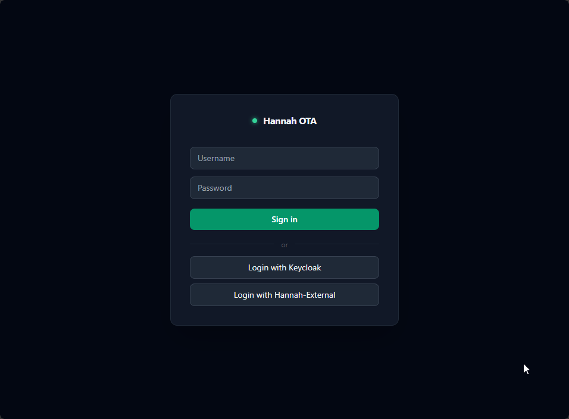

2. Hast du noch kein Konto, klicke unten auf **Register**.

    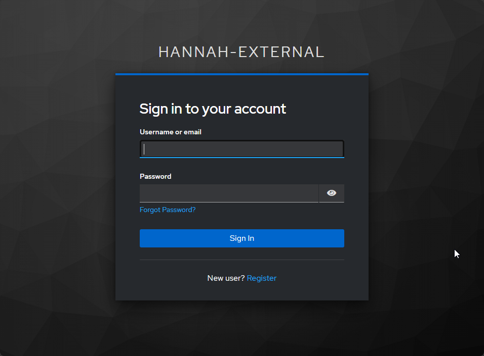

3. Fülle das Formular aus: Benutzername, E-Mail-Adresse, Vor- und Nachname.

    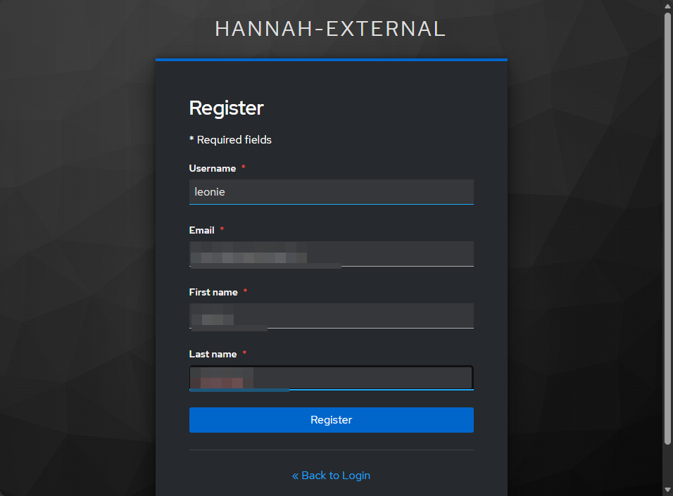

4. Du bekommst eine E-Mail, mit der du deine Adresse bestätigst. Absender ist
   `hannah-external@leonie.network`. Kommt nichts an, schau im Spam-Ordner nach.

    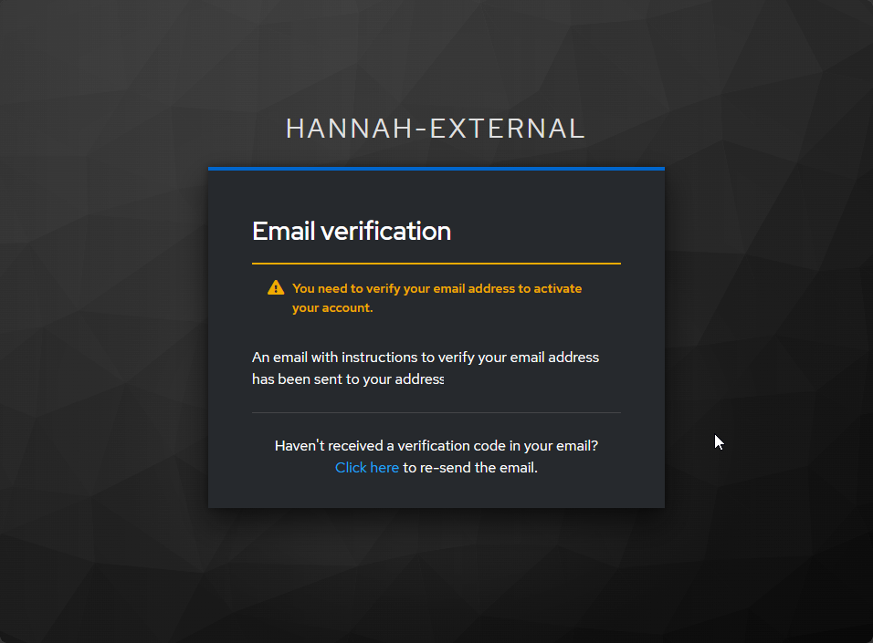

5. Klicke in der E-Mail auf den Link. Er ist nur **5 Minuten** gültig. Ist er abgelaufen,
   lässt du dir auf der Hinweisseite eine neue E-Mail schicken.

    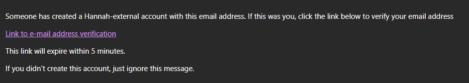

6. Vergib ein Passwort.

    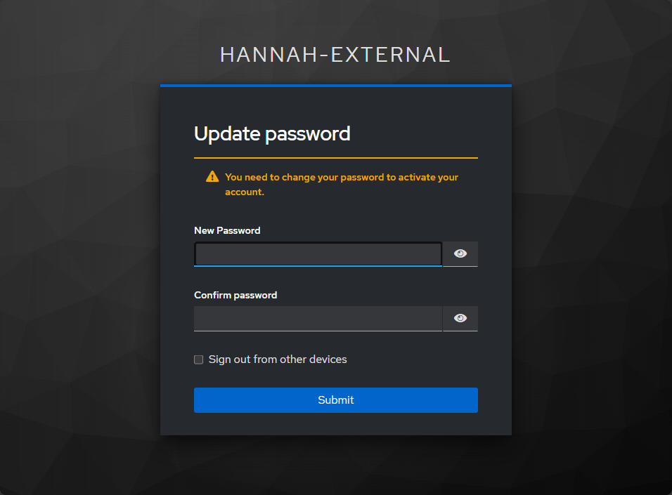

7. Danach lehnt der Update-Server die Anmeldung zunächst ab („Your account has not been
   approved yet"). Das ist gewollt: Neue Konten muss die Entwicklerin **einmal freischalten**.
   Schreib sie dafür im
   [Hannah-Thread im ioBroker-Forum](https://forum.iobroker.net/topic/84378/hannah-open-source-smart-home-sprachassistentin)
   an und nenne deinen Benutzernamen.

    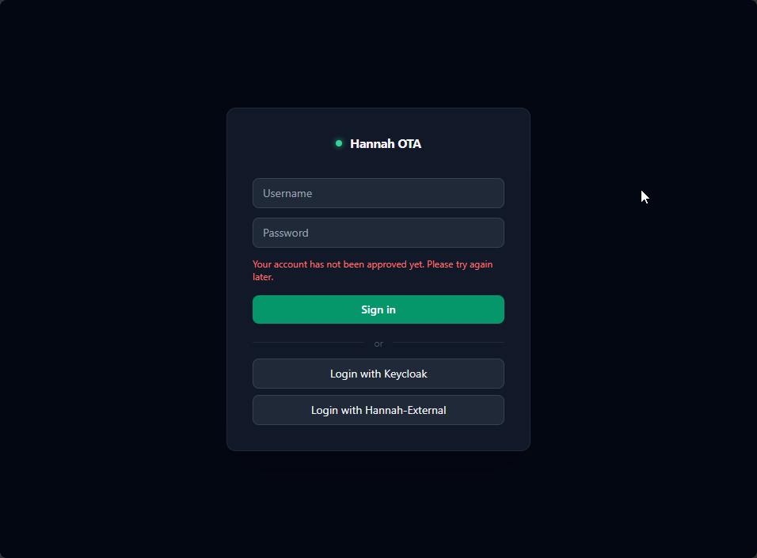

8. Sobald dein Konto freigeschaltet ist, meldest du dich wie oben mit **Login with
   Hannah-External** an. Du siehst die Kanäle, die es gibt.

    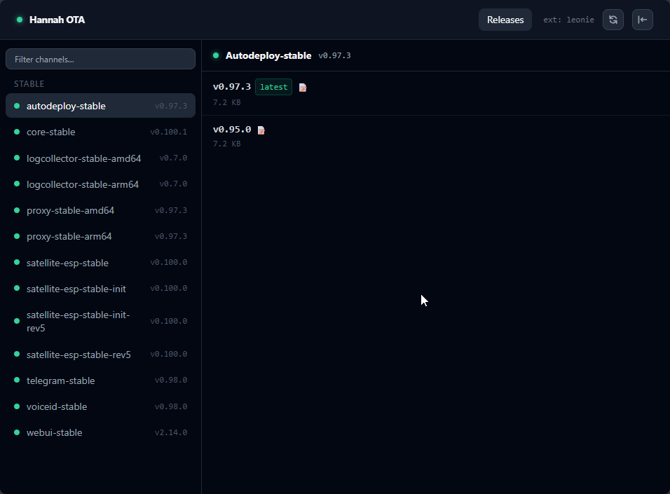

## Service Account und Token anlegen

Programme melden sich nicht mit deinem Konto an, sondern mit einem **Service Account**. Der
hat nur die Rechte, die du ihm gibst, und einen eigenen Token. Du kannst mehrere anlegen, zum
Beispiel einen für deine Satelliten und einen für AutoDeploy.

1. Klicke oben rechts auf deinen Benutzernamen. Es öffnet sich das Fenster **My Account**.
   Klicke bei **Service Accounts** auf **+ New**.

    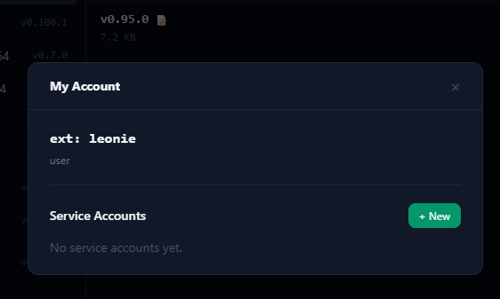

2. Gib einen Namen für den Service Account ein, zum Beispiel `satellite-update`.

    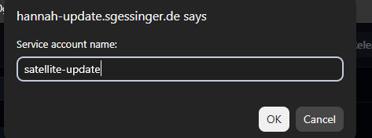

3. Der Service Account erscheint in der Liste. Klicke dort auf **Permissions**.

    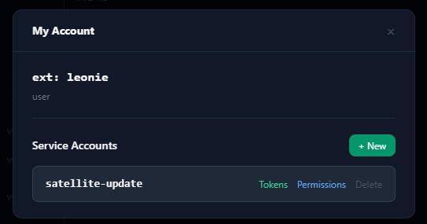

4. Lass bei **What should this account be able to do?** das Preset **Get updates** gewählt.
   Damit darf der Service Account auf neue Versionen prüfen und sie herunterladen, mehr
   brauchst du normalerweise nicht. Wähle unter **On which channels?** die Kanäle aus, die du
   brauchst (eine Übersicht steht [unten](#welche-rechte-brauche-ich)). Mit dem Feld **Filter**
   findest du Kanäle schneller, mit **Select all** wählst du alle aus. Speichere die Auswahl
   mit dem grünen Button unter der Liste.

    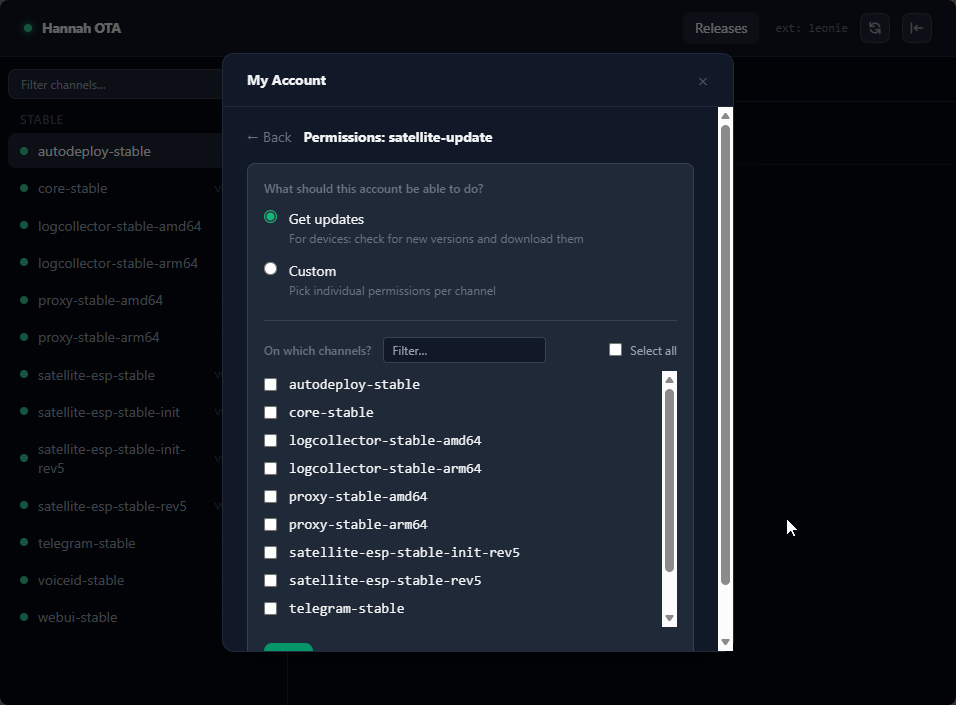

    Das Preset **Custom** erlaubt feinere Rechte pro Kanal. Es ist für Sonderfälle gedacht,
    für normale Nutzer reicht **Get updates**.

5. Gehe zurück und klicke beim Service Account auf **Tokens**, danach auf **Create Token**.

    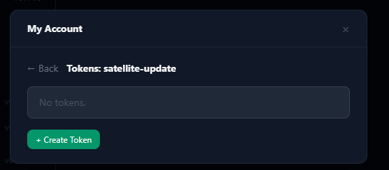

6. Gib dem Token einen Namen. Danach fragt der Update-Server, für wie viele Tage er gültig sein soll.
   Lässt du das Feld leer, läuft er nie ab.

    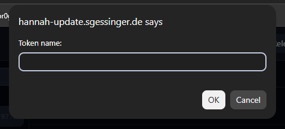

    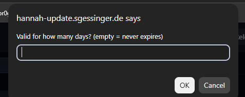

7. Kopiere den Token **sofort**. Er wird kein zweites Mal angezeigt. Hast du ihn verloren,
   legst du einen neuen an.

    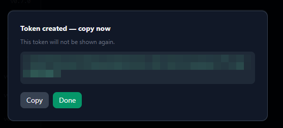

## Welche Rechte brauche ich?

Wähle das Preset **Get updates** und hake die passenden Kanäle an:

| Wofür | Kanäle |
|---|---|
| Satelliten (OTA-Updates) | `satellite-esp-stable-rev5` |
| ioBroker-Adapter (Satelliten flashen) | `satellite-esp-stable-init-rev5` |
| AutoDeploy und Installation der Dienste | alle Kanäle **außer** den Satelliten-Kanälen, zum Beispiel `core-stable`, `telegram-stable` und `proxy-stable-amd64` bzw. `proxy-stable-arm64` |

## Token eintragen

Überall, wo du den Update-Server verwendest, gehört der Token als **Bearer-Token** hinein.

| Wo | Was du einträgst |
|---|---|
| **Satellit** | In der Web-Oberfläche des Satelliten unter **Einstellungen** im Feld **Update-Server Token**. Das brauchst du bei bereits laufenden Satelliten. Siehe [Konfiguration](../satellite/configuration.md#firmware) |
| **ioBroker-Adapter** | Im Admin-Tab unter **Firmware** im Feld **Auth Token**, damit der Satellite Manager die Installationsdateien laden kann. Siehe [Konfiguration](../iobroker-adapter/configuration.md#firmware). Optional trägst du ihn auch bei den **Satellite Defaults** ein. Der Adapter schreibt ihn dann beim Flashen in die Einstellungen neuer Satelliten, damit diese ihre OTA-Updates holen können |
| **AutoDeploy** | In der Konfigurationsdatei als `token`, siehe [Konfiguration](../autodeploy/configuration.md#globale-schlussel) |
| **Installation von Core** (`install.sh`) | Als Umgebungsvariable `UPDATE_SERVER_TOKEN`, siehe [Installation](../core/installation.md) |

## Dateien manuell herunterladen

Du kannst Releases auch von Hand laden, zum Beispiel die Installationsdateien für einen
Satelliten ([Ohne Satellite Manager flashen](../satellite/commissioning.md#ohne-satellite-manager-flashen-und-einrichten)).

**Im Browser:** Melde dich an, wähle links den Kanal und klicke beim gewünschten Release
auf das Download-Symbol.

**Auf der Kommandozeile:** Schick den Token als `Authorization`-Header mit. Mit `curl`:

```bash
curl -L -H "Authorization: Bearer <dein-token>" \
  -o hannah_satellite_init.zip \
  "https://hannah-update.sgessinger.de/releases/latest?channel=satellite-esp-stable-init-rev5"
```

In der Windows-PowerShell:

```powershell
Invoke-WebRequest -Headers @{ Authorization = "Bearer <dein-token>" } `
  -OutFile hannah_satellite_init.zip `
  "https://hannah-update.sgessinger.de/releases/latest?channel=satellite-esp-stable-init-rev5"
```
