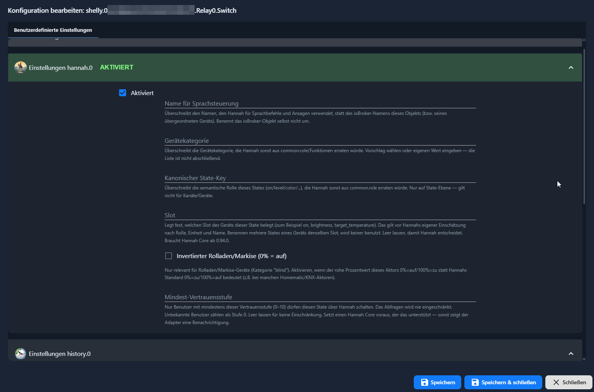

# Smart-Home-Integration

Diese Seite erklärt, wie aus einem ganz normalen ioBroker-Gerät ein Gerät wird, das
Hannah per Sprache versteht und steuert — vom Grundkonzept über ein Beispiel bis zur
Frage, was passiert, wenn ein Kommando mal nicht eindeutig ist.

Voraussetzung ist eine laufende Verbindung zwischen Hannah und ioBroker über den
[ioBroker-Adapter](../components/iobroker-adapter/index.md) — die
[Konfiguration](../components/iobroker-adapter/configuration.md) dort steht bereits,
wenn der Health-Check erfolgreich ist.

## Grundkonzept: vier Kategorien

ioBroker kennt viele Objekttypen; für Hannah zählt praktisch nur einer: der **State**
(einzelner Wert, z. B. "Licht Küche an/aus" oder "Temperatur Wohnzimmer"). Aus jedem
relevanten State liest der Adapter vier Dinge heraus:

| Kategorie | Beantwortet | Woher |
|---|---|---|
| **Raum** | In welchem Zimmer steht/wirkt das Gerät? | ioBroker-Enum `enum.rooms.*` |
| **Funktion** | Wofür ist der State da (Licht, Heizung, Rollladen, …)? | ioBroker-Enum `enum.functions.*`, plus Fallback über Namens-Stichwörter |
| **Rolle** | Was für eine Art Wert ist das technisch (Schalter, Dimmer, Sensor, …)? | ioBroker-eigenes `common.role`-Feld am State |
| **Wert** | Boolean, Zahl, Text, Auswahlliste oder Farbe? | ioBroker-eigenes `common.type`/`common.states` |

Räume und Funktionen musst du in ioBroker selbst pflegen (Standard-ioBroker-Funktion,
nichts Hannah-Spezifisches) — Rolle und Werttyp bringt praktisch jeder Adapter für seine
Geräte schon korrekt mit.

## Wie Hannah ein Gerät einordnet

Aus der **Rolle** leitet der Hannah-Adapter automatisch eine **Kategorie** und einen
**canonical key** (den internen "Schlüssel" für genau diesen Wert am Gerät) ab. Die
wichtigsten Fälle:

| ioBroker-Rolle | Hannah-Kategorie | canonical key |
|---|---|---|
| `switch.light` | `light` (Lampe) | `on` |
| `level.dimmer` | `light` | `level` |
| `level.color*` | `light` | `color` |
| `switch`/`switch.power` (schreibbar) | `socket` (Steckdose) | `on` |
| `level.blind`/`level.curtain` | `blind` (Rollladen) | `level` |
| `sensor.window` | `window` (Fenster) | `open` |
| `sensor.door`/`indicator.open` | `door` (Tür) | `open` |
| `level.temperature` | `thermostat` | `expected` (Soll-Temperatur) |
| `value.temperature` | `temperature_sensor` (Temperatursensor), an einem Thermostat `thermostat` | `current` |
| `value.humidity` | `humidity_sensor` (Feuchtesensor) | `current` |
| `value.brightness` | `illuminance_sensor` (Helligkeitssensor) | `illuminance` |

Findet sich keine passende Rolle, schaut Hannah ersatzweise auf den Namen der
**Funktion** (z. B. "Heizung"/"Therm" → Thermostat, "Fenster" → Fenster) — weniger
zuverlässig als eine saubere Rolle, aber ein brauchbarer Fallback.

### Klassen und Slots

Seit Hannah Core 0.94.0 und dem ioBroker-Adapter 1.5.3 beschreibt der Adapter jedes Gerät als
**Klasse** mit **Slots**. Eine Klasse ist die Art des Geräts: Lampe, Steckdose, einfacher
Schalter, Thermostat, Klimaanlage, Rollladen, Sensor, Kontakt (Fenster/Tür) oder
"Sonstiges". Ein Slot ist ein einzelner Wert oder eine Funktion daran, mit fester Skala:
`on` (an/aus), `brightness` (0–100 %), `color` (RGB), `color_temperature` (Kelvin),
`position` (100 % = offen), `target_temperature` (°C) und so weiter, die vollständige
Liste steht [unten](#slots).

Was ein Gerät kann, ergibt sich allein aus seinen Slots: Eine Lampe ohne `brightness`
lässt sich nicht dimmen, und Hannah sagt dir das, statt still nichts zu tun. Die Klasse
folgt aus den Slots, nicht umgekehrt. Die "Kategorie" und der "canonical key" aus dem
Abschnitt davor sind das ältere Vokabular für dasselbe, die Override-Felder benutzen
es noch.

Ein paar Regeln, die man kennen sollte:

- **Ein Gerät ist der Kanal oder Geräteordner**, in dem die States liegen. Mehrere Kanäle
  eines Geräts fasst der Adapter nur zusammen, wenn sie im selben Raum und in derselben
  Funktion liegen und kein Slot doppelt vorkäme. Die Relais einer Mehrfachsteckdose
  bleiben deshalb eigene Geräte.
- **Was nicht erkannt wird, bleibt als generischer Slot am Gerät.** Ein Gerät, von dem
  Hannah gar nichts erkennt (z. B. ein reiner Konfigurationskanal), wird nicht gemeldet.
- **Trägst du ein ganzes Gerät in Raum und Funktion ein, kommen alle States darunter an**,
  auch Timer, Grenzwerte und andere Einstellungen. Willst du nur eine Funktion, trag nur
  diesen einen State in Raum und Funktion ein, dann kennt Hannah nur ihn.
- **Der Diagnose-Tab des Adapters zeigt, was bei Hannah ankommt** und warum ein State
  oder Gerät fehlt, siehe [Diagnostics](../components/iobroker-adapter/configuration.md#diagnostics).
  Der Weg dahin: erst dort nachsehen, dann am Override drehen.

### Von Hand korrigieren

Ordnet Hannah ein Gerät falsch ein (z. B. weil ein Adapter eine unübliche Rolle
verwendet), musst du nicht den ioBroker-State selbst umbauen: In den
**benutzerdefinierten Einstellungen** eines States (Reiter "Objekte" im Admin, Zahnrad am
State) gibt es einen Abschnitt für die Adapterinstanz, z. B. `hannah.0`, mit dem Schalter
"Aktiviert". Sobald du ihn setzt, erscheinen die folgenden Felder. Ohne den Schalter wird
nichts davon gelesen.

| Feld | Schlüssel | Wirkung |
|---|---|---|
| Aktiviert | `enabled` | Schaltet den Override ein. Den Schalter liefert ioBroker selbst |
| Name für Sprachsteuerung | `name` | Wie Hannah das Gerät bei Sprachbefehlen und Ansagen nennt, ohne den ioBroker-Objektnamen zu ändern |
| Gerätekategorie | `type` | Ein Hinweis, was für ein Gerät das ist. Kein Befehl: Was das Gerät ist, ergibt sich aus seinen Slots, der Hinweis entscheidet in Zweifelsfällen (ein Schalter, der eine Lampe ist, ein Pegel, der eine Rollladenposition ist) |
| Kanonischer State-Key | `canonicalKey` | Was dieser State bedeutet, im älteren Vokabular (`on`, `level`, `current`, …). Mit Hannah Core ab 0.94.0 besser **Slot** nehmen |
| Slot | `slot` | Welchen Slot des Geräts dieser State belegt. Gilt vor Hannahs eigener Einschätzung nach Rolle, Einheit und Name. Braucht Hannah Core ab 0.94.0 und den ioBroker-Adapter ab 1.8.0 |
| Invertierter Rollladen | `shutterInverted` | Für Rollläden, deren Prozentwert 0 % = auf bedeutet, siehe [unten](#die-hannah-kategorien-im-detail) |
| Mindest-Vertrauensstufe | `neededTrust` | Wer diesen State über Hannah schalten darf (0–10), siehe [Geräte schützen](#gerate-schutzen) |

**Gerätekategorie** (`type`): `light` (Lampe), `socket` (Steckdose), `climate` (Klimaanlage),
`blind` (Rollladen), `window` (Fenster), `door` (Tür), `thermostat`, `temperature_sensor`
(Temperatursensor), `humidity_sensor` (Feuchtesensor), `illuminance_sensor`
(Helligkeitssensor), `air_quality_sensor` (Luftqualitätssensor). Eigene Werte kannst du tippen.

**Kanonischer State-Key** (`canonicalKey`): `on`, `level`, `color`, `colorTemp`, `current`,
`expected`, `illuminance`, `open`, `iaq`, `co2_equiv`, `voc_equiv`, `power`. Eigene Werte
kannst du tippen.

**Slot** (`slot`):

| Slot | Bedeutung |
|---|---|
| `on` | an oder aus |
| `brightness` | Helligkeit, 0–100 % |
| `color` | Farbe (RGB) |
| `color_temperature` | Farbtemperatur in Kelvin |
| `position` | Stellung eines Rollladens, 100 % = offen |
| `tilt` | Lamellenneigung eines Rollladens |
| `stop` | Stopp-Befehl eines Rollladens |
| `target_temperature` | Soll-Temperatur eines Thermostats oder einer Klimaanlage, in °C |
| `temperature` | gemessene Temperatur, in °C |
| `humidity` | relative Luftfeuchte |
| `illuminance` | Umgebungshelligkeit |
| `pressure` | Luftdruck |
| `co2` | CO₂-Wert |
| `iaq` | Luftqualitätsindex |
| `voc` | VOC-Wert |
| `power` | Leistung, in W |
| `energy` | Energie, in kWh |
| `voltage` | Spannung, in V |
| `current` | Strom, in A |
| `open` | Kontakt offen oder zu (Fenster, Tür) |
| `motion` | Bewegung erkannt |
| `valve` | Stellung eines Ventils |
| `mode` | Betriebsart einer Klimaanlage |
| `fan_speed` | Lüfterstufe einer Klimaanlage |

Die Einstellungen gelten **nur am State selbst**, nicht an Kanal oder Gerät — ioBroker
bietet sie dort nicht an. Ein Override schlägt immer die automatische Erkennung, du kannst
also gezielt nur einen einzelnen State korrigieren, ohne das ganze Gerät anzufassen.

Für Werte, die ein ganzes Gerät betreffen, gilt: Der Wert darf an **jedem** State des Geräts
stehen. Das trifft `name`. Tragen mehrere States denselben Wert ein, ist das ein Override.
Tragen sie verschiedene Werte ein, gilt keiner, das Gerät behält seinen ioBroker-Namen, und
der Diagnose-Tab sagt dir, welche States sich widersprechen. Benennen mehrere States
denselben **Slot**, wird ebenfalls keiner benutzt, und der Diagnose-Tab meldet es. Ein Slot,
den es nicht gibt, wird ignoriert und gemeldet.

### Geräte schützen

Manche Geräte soll nicht jeder schalten dürfen — ein Türschloss zum Beispiel, oder die
Heizung. Dafür trägst du am jeweiligen State im Hannah-Reiter eine
**Mindest-Vertrauensstufe** von 0 bis 10 ein. Hannah schaltet diesen State dann nur noch
für Nutzer, deren [Trust-Level](users.md#trust-level) mindestens so hoch ist. Leer lassen
heißt: keine Einschränkung, wie bisher.

Was du dabei wissen solltest:

- **Nur Schalten ist geschützt, Fragen nie.** "Ist die Haustür zu?" beantwortet Hannah
  jedem.
- **Wer nicht erkannt wird, zählt als Gast** (Trust-Level 0). Das betrifft Stimmen, die
  Hannah [keiner Person zuordnen](../components/voiceid/index.md) kann, und Telegram- oder Chat-Konten, die
  mit keinem Nutzer [verknüpft](users.md#verknupfte-konten) sind.
- **Bei Sammelbefehlen** wie "alle Lichter im Flur aus" schaltet Hannah alle Geräte, die
  du schalten darfst, und sagt dir, welche sie ausgelassen hat.
- **Befehle über den `textCommand`-State des Adapters sind nicht eingeschränkt.** Wer
  diesen State in ioBroker beschreiben kann, kann das Gerät dort ohnehin direkt schalten.
- Die Einstellung wirkt **sofort**, ohne den Adapter neu zu starten.

!!! warning "Hannah Core muss das unterstützen"
    Die Mindest-Vertrauensstufe braucht einen aktuellen Hannah Core. Ist er zu alt,
    schaltet er geschützte Geräte weiterhin für jeden. Der Adapter merkt das und zeigt in
    ioBroker eine Benachrichtigung ("Hannah Core does not support trust levels per state
    yet") — dann Hannah Core aktualisieren. Nach dem Update verschwindet die
    Benachrichtigung von selbst.

## Die Hannah-Kategorien im Detail

Pro Kategorie kennt Hannah feste "canonical keys" mit definiertem Wertebereich:

| Kategorie | Keys (Wertebereich/Format) |
|---|---|
| `light` (Lampe) | `on` (an/aus) · `level` (0–100 %) · `color` (Hex-Farbe `#RRGGBB`, oder das Wort "warm" für warmweiß) |
| `socket` (Steckdose) | `on` (an/aus) · `power` (Watt, nur lesend) |
| `climate` (Klimaanlage) | `on` (an/aus) · `mode` (`cool`/`heat`/`dry`/`fan_only`/`auto`, auf Deutsch angesagt) · `current`/`expected` (°C) · `fanSpeed` (`low`/`medium`/`high`/`auto`) |
| `blind` (Rollladen) | `level` (0–100 %, **0 = zu, 100 = auf** — Hannahs Standardkonvention) |
| `window` / `door` (Fenster / Tür) | `open` (offen/geschlossen) |
| `thermostat` | `current`/`expected` (°C) |
| `temperature_sensor` (Temperatursensor) | `current` (°C) |
| `humidity_sensor` (Feuchtesensor) | `current` (0–100 %) |
| `illuminance_sensor` (Helligkeitssensor) | `illuminance` (Lux, nach oben offen) |
| `air_quality_sensor` (Luftqualitätssensor) | `iaq` (Luftqualitätsindex 0–500, siehe unten) · `co2_equiv`/`voc_equiv` (ppm) |

**Rollladen-Sonderfall**: manche Aktoren (z. B. bestimmte Homematic-/KNX-Antriebe)
melden ihre Position genau andersherum (0 % = offen). Statt jedes Mal "andersherum"
mitzudenken, setzt du an genau diesem State das Override-Feld **shutterInverted** — ab
dann rechnet Hannah automatisch um, und du sagst weiterhin ganz normal "Rollladen zu".

**Fenster/Tür-Tristate**: manche Kontakte (z. B. Homematic-Fensterkontakte mit Rolle
`state`) melden nicht nur offen/zu, sondern drei Zustände (0 = zu, 1 = gekippt,
2 = offen). Für die generische Rolle `state` greift die automatische Erkennung nicht —
hier brauchst du den Override und setzt canonicalKey auf `open`. Eine eigene Wortform
für "gekippt" gibt es bei Hannah bewusst nicht: gekippt zählt für die Sprachsteuerung
als offen, eine reine Boolean-Auswertung (0 → zu, alles andere → offen) reicht.

**Luftqualität in Worten**: den rohen IAQ-Index sagt dir Hannah nie als Zahl vor,
sondern übersetzt ihn: bis 50 "gut", bis 100 "okay", bis 150 "leicht belastet", darüber
"schlecht".

## Beispiel-Walkthrough: einfach → komplex

### 1. Einfach: eine Lampe

Ein Zigbee-Lampenschalter mit Rolle `switch.light` in Raum "Küche", Funktion "Licht".
Hannah erkennt: Kategorie `light`, Key `on`. Sagst du *"Licht Küche an"*, schreibt Hannah
`on = true` auf genau diesen State — fertig, kein Override nötig.

### 2. Mittel: ein invertierter Rollladen

Ein Rollladenaktor mit Rolle `level.blind` in Raum "Schlafzimmer" meldet 0 % als
*offen* statt wie üblich als *zu*. Ohne Anpassung würde *"Rollladen Schlafzimmer zu"*
das Gegenteil vom Gewünschten tun. Lösung: im ioBroker-Objektbaum am State den
Hannah-Override aktivieren und **shutterInverted** setzen. Ab sofort rechnet Hannah die
Prozentangabe intern um, bevor sie den Wert schreibt — der Sprachbefehl bleibt
unverändert richtig.

### 3. Komplex: eine Klimaanlage

Eine Klimaanlage bringt mehrere States gleichzeitig mit: `mode` (Betriebsart),
`fanSpeed` (Lüfterstufe), `expected` (Soll-Temperatur). Sagst du *"Klimaanlage
Wohnzimmer auf kühlen stellen, Lüfter hoch"*, übersetzt Hannah "kühlen" → `mode: cool`
und "hoch" → `fanSpeed: high` (die deutschen Wörter dafür stehen unter
[Erweiterte Einstellungen → NLU-Wortlisten](settings.md#nlu-wortlisten) und lassen sich
dort erweitern, falls du andere Formulierungen bevorzugst) und schreibt beide States in
einem Rutsch.

## Wie Hannah ein Kommando zerlegt

1. Die Spracherkennung liefert reinen Text (z. B. *"mach das licht in der küche an"*).
2. Der NLU-Teil zerlegt den Text in **Intent** (Aktion), **Raum** und **Gerät** —
   erkannte Füllwörter ("mach", "in der") werden ignoriert, relevante Substantive
   ("licht", "küche") zugeordnet.
3. Hannah schreibt den erkannten Intent (Name, Raum, Gerät, Wert) mit ins Log — nützlich
   für die Fehlersuche, siehe unten.

### Wenn's nicht eindeutig ist: Rückfragen

Hannah fragt aktiv zurück, statt zu raten, in drei Fällen:

- **Mehrdeutige Kategorie** — z. B. *"Küche hoch"* könnte Rollladen oder Klimaanlage
  meinen → *"Meinst du Rollladen oder Klimaanlage?"*
- **Mehrdeutiger Raum** — mehrere Räume passen zum genannten Begriff →
  *"Welchen Raum meinst du — Küche oder Wohnzimmer?"*
- **Mehrdeutiges Gerät im selben Raum** — z. B. zwei Rollläden ("Seite 1"/"Seite 2") →
  *"Welches Gerät meinst du — Rolladen Seite 1 oder Rolladen Seite 2?"*

Deine Antwort auf so eine Rückfrage wird tolerant ausgewertet (auch "die erste", "den
zweiten" funktioniert). Passt die Antwort zu keiner der Optionen, verwirft Hannah die
Rückfrage kommentarlos und behandelt deinen nächsten Satz wieder ganz normal.

### Bestätigung und Timeout

Nach einem Steuerbefehl wartet Hannah kurz (Standard: 3 Sekunden, einstellbar über
`iobroker.feedback_timeout` in [Core → Konfiguration](../components/core/configuration.md#sonstiges))
auf die tatsächliche Rückmeldung des Geräts. Kommt sie rechtzeitig, ist der Vorgang
lautlos erledigt. Bleibt sie aus, sagt Hannah aktiv Bescheid: *"Gerät antwortet
nicht — möglicherweise offline."*

## Troubleshooting: was im Core-Log steht

Bei Problemen lohnt ein Blick ins Core-Log (siehe
[Installation → Prüfen, ob es läuft](installation.md)):

| Log-Zeile (sinngemäß) | Bedeutung |
|---|---|
| `execute: Kein Raum erkannt.` | Weder Raum noch konkretes Gerät im Kommando erkannt |
| `execute: Keine Geräte für Raum '…' gefunden.` | Raum erkannt, aber kein passendes Gerät darin |
| `execute: …, N Gerät(e) gefunden, state='…', value=…` | Erfolgreich zugeordnet und Befehl abgesetzt — der Normalfall |
| `Unbekannter State-Suffix '…' … Live-Update wird verworfen` | Ein ioBroker-Update kam für einen Wert, den Hannah keinem bekannten canonical key zuordnen kann — meist ein Hinweis, dass dieser State einen Override braucht |
| `Timeout: keine Bestätigung für …` | Gerät hat innerhalb des Zeitfensters nicht reagiert |
